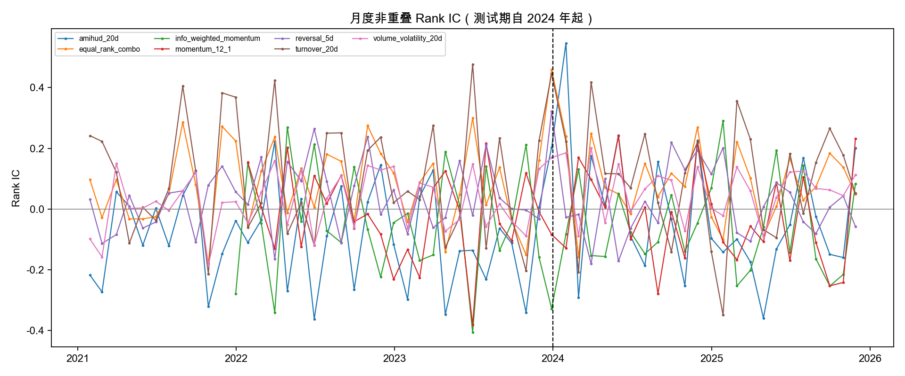
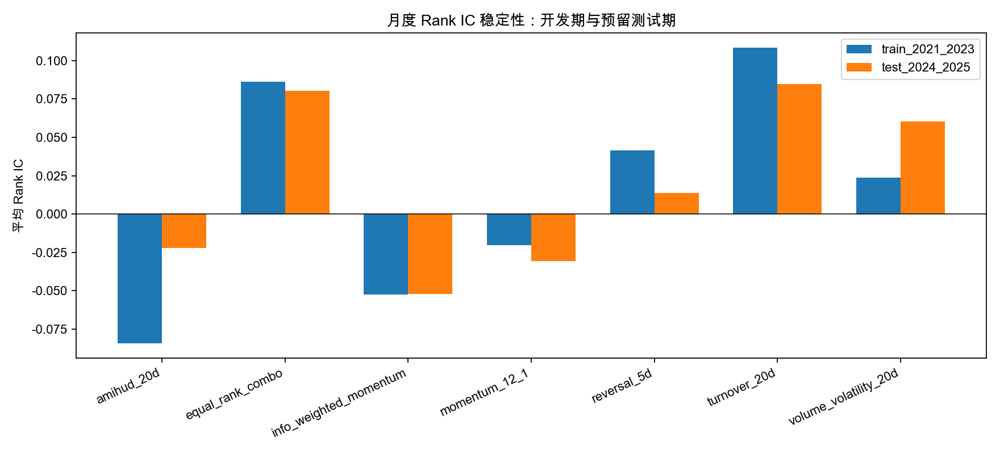
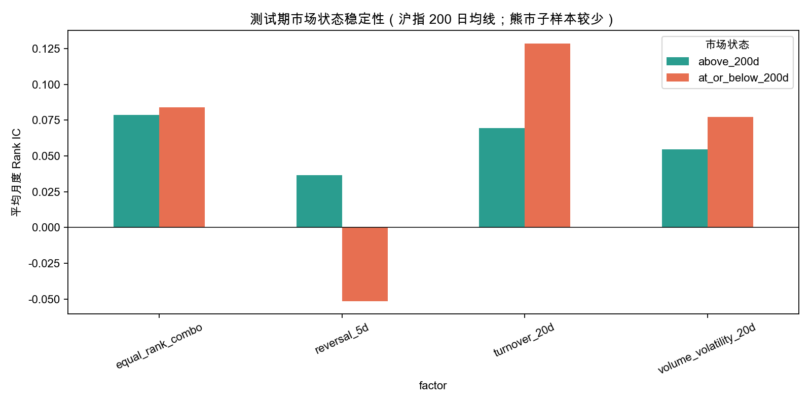
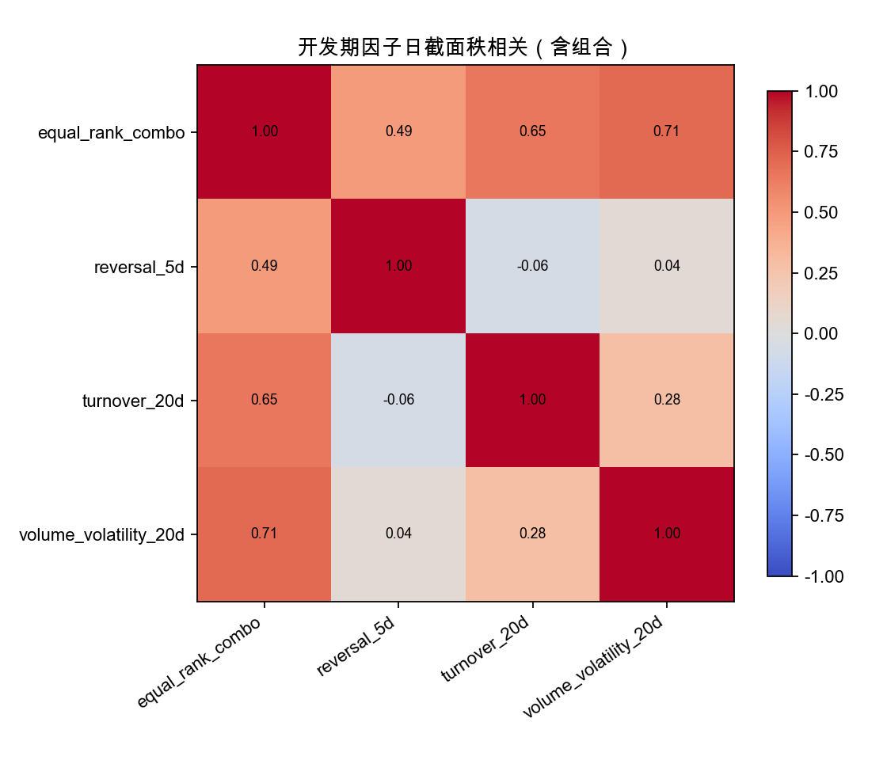
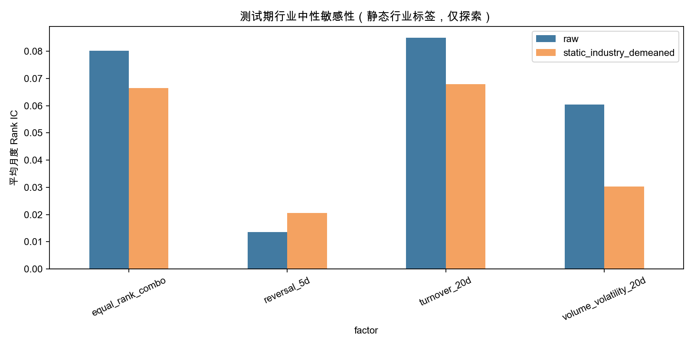
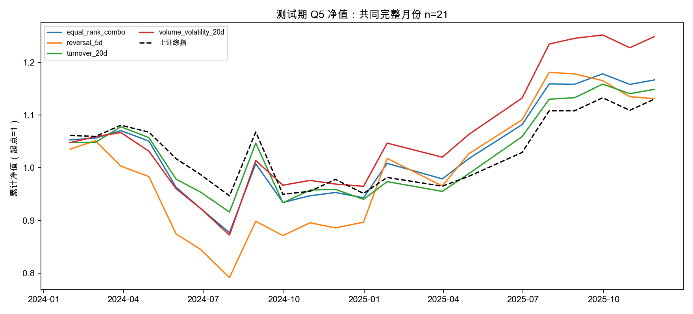
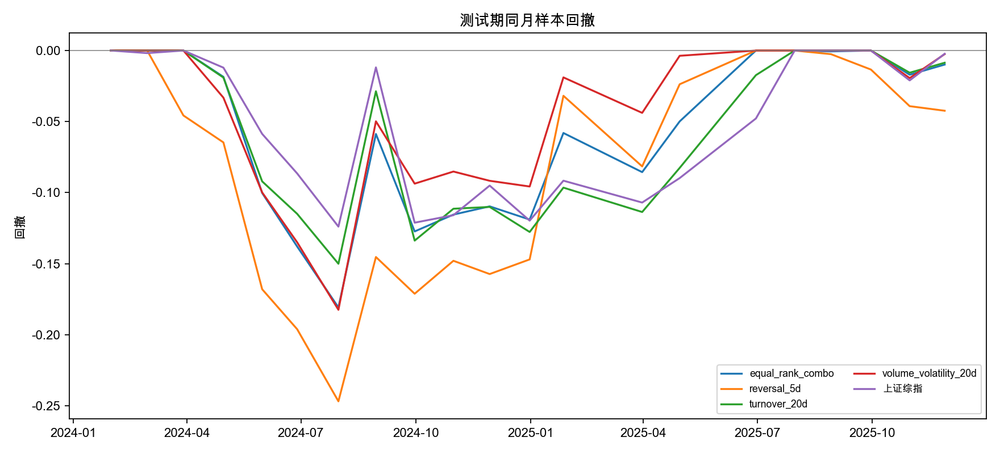
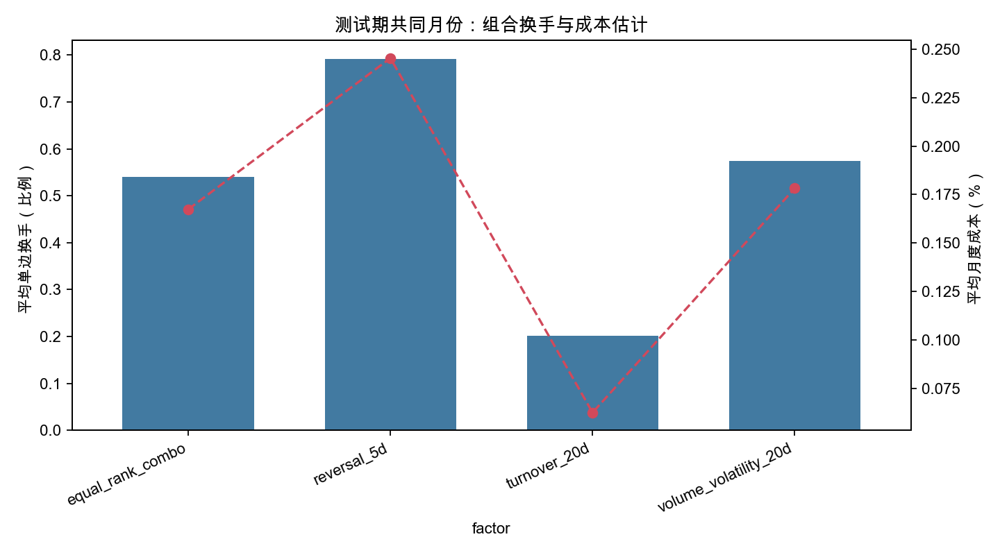

# A 股价量因子第二阶段研究：真实行情、稳健性与等权组合

**版本：** v2.0；**研究期：** 2021-01 至 2025-12；**开发期：** 2021-01 至 2023-12；**预留测试期：** 2024-01 至 2025-12。  
**研究对象：** 公开数据源中出现的 4,902 个六位证券代码；这不是完整历史 A 股可投资股票池。  
**重要边界：** 本项目是公开历史行情上的因子诊断，不是股息因子研究，也不是可直接实盘的回测。当前数据缺少历史 ST、停牌、涨跌停、上市/退市状态、市值和历史行业标签。所有结果均据此解释。

## 1. 研究问题与结论摘要

本阶段回答三个问题：第一，前一阶段发现的价量因子能否在非重叠月度收益和保留测试期中保持排序能力；第二，开发期筛出的因子是否提供相似或互补信息；第三，简单组合在显式成本假设下是否优于单因子及上证综指。因子方向、筛选规则及组合权重均只由开发期决定，测试期只用于一次性评价。

开发期规则为：在 2021–2023 的原单因子表中，选择平均 Rank IC 为正且 Newey–West t 统计量至少 1.96 的因子；之后依照开发期平均日截面秩相关，剔除与已保留因子绝对相关不低于 0.70 的冗余项。实际入选为 20 日低换手率、20 日成交量稳定性和 5 日反转。组合是三项月末截面百分位秩的等权平均，要求三项信号都存在，不进行测试期拟合或择权。

测试期非重叠月度 Rank IC：低换手率 0.0849（NW t=3.47，23 个月）；成交量稳定性 0.0605（t=6.45，23 个月）；5 日反转 0.0137（t=0.48，23 个月）；等权秩组合 0.0802（t=6.57，23 个月）。传统 12−1 动量为 −0.0308（t=−1.14），信息加权动量为 −0.0519（t=−2.59）；Amihud 因子测试期均值 −0.0222（t=−0.59）。这说明不是所有候选因子都通过样本外检验，反转的开发期有效性也没有在该测试窗得到确认。

Q5 多头组合在 21 个共同完整测试月份配对后，等权秩组合的净累计收益为 16.7%，年化收益 9.2%，年化波动 18.6%，最大回撤 −18.1%，零无风险利率夏普 0.56；同期上证综指年化收益 7.2%，组合年化超额约 2.0 个百分点。成交量稳定性单因子在同月配对样本年化净收益 13.5%，夏普 0.75，回撤 −18.3%。因此本次结果**没有证明组合优于最佳单因子**；组合更像是分散化候选，未来需要更长且完整的点时数据验证。回测按假设成本扣减，不能视作实际可实现收益。

## 2. 数据来源与覆盖

本地数据来自公开 GitHub 仓库 `newbiestring-lang/astock` 的固定快照，具体文件、commit、下载时间及 SHA-256 见仓库 `data/raw/astock/SOURCE_README.md`、`data/processed/data_manifest.json` 和 `run_metadata.json`。日线字段包含证券代码、日期、开高低收、成交量、成交额、换手率和涨跌幅；OHLC 为源文件提供的前复权价格。上证综指日线单独用于市场状态和基准。

| 字段 | 使用方式 | 限制 |
|---|---|---|
| 日期、代码 | 对齐日频截面及月末信号 | 证券覆盖依赖源文件，不能证明历史完整 |
| 开、高、低、收 | 价量因子及开盘至开盘前瞻收益 | OHLC 前复权；无逐日复权因子可做独立核验 |
| 成交量、成交额、换手率 | Amihud、成交量变异系数、换手率 | 无盘口深度、涨跌停和逐笔成交 |
| 行业标签 | 静态行业中性敏感性 | 标签是当前快照，不是点时历史分类 |
| 上证综指 | 同区间比较、200 日均线市场状态 | 单一宽基基准，不覆盖全 A 股风格 |

本数据没有现金分红、分红公告/登记/除权日、市值历史、股本、ST、停牌、涨跌停可成交状态、上市/退市历史等字段。因此不能声称此版本研究股息率，也没有执行市值控制、真实历史行业中性或历史存续股票池重建。价格前复权会反映源方调整后的价格路径，但不能替代股息公告点时数据，也无法核实除权处理细节。静态行业结果仅作为探索性检查。

## 3. 因子定义与信号时点

所有因子在每月最后一个源数据交易日收盘后计算，作为下月信号；成交假设为下一个自然月首个有数据交易日开盘，持有至该月最后一个有数据交易日开盘。收益为前复权开盘价之比减一。相邻月收益区间首尾相接，不重叠。

| 因子（高值代表） | 公式（截至信号日） |
|---|---|
| Amihud 流动性（高值=更易交易） | `−1e6 × mean_20(|日收盘收益| / 成交额)` |
| 20 日换手（高值=低换手） | `−mean_20(日换手率百分比 / 100)` |
| 5 日反转（高值=近期跌幅更大） | `−(收盘_t / 收盘_{t−5} − 1)` |
| 成交量稳定性（高值=更稳定） | `−std_20(成交量) / mean_20(成交量)` |
| 12−1 动量 | `收盘_{t−21} / 收盘_{t−252} − 1` |
| 信息加权动量 | `sum_231(日收益 × min(成交量 / 20 日均量, 5))`，跳过最近 21 个交易日 |

每个日期的 Rank IC 只使用当日因子和随后完整收益标签均可得的证券；至少 50 个有效证券才保留月度截面。滚动窗口至少要求半窗（动量因其定义使用既定较长最小覆盖）。不对未来的公告类字段做回填；本数据没有公告字段，所以本研究不构造分红信号。

## 4. 统计检验

### 4.1 IC 与秩组合

Rank IC 是同一信号日因子横截面秩与未来收益横截面秩的 Spearman 相关。均值表示平均排序方向；ICIR 是均值除以时间序列标准差；正 IC 比例表示 IC 大于零的月份比例。Newey–West 标准误允许时间序列自相关异方差，报告的 t 与 p 值不是独立同分布假设下的简单显著性。测试期只有 23 个月，显著性不应被解读为持久规律。

Q5 组合按月将有效股票按因子分五组并计算组收益；本轮增强分析重点输出 Q5 月度多头组合。由于源样本未覆盖完整历史上市状态、且停牌/涨跌停缺失，分组和持仓都可能带入存续偏差及不可成交标的。测试期因子 IC 结果如下：

| 因子 | 月数 | 平均 Rank IC | NW t | 正 IC 比例 | 测试含义 |
|---|---:|---:|---:|---:|---|
| 20 日低换手 | 23 | 0.0849 | 3.47 | 69.6% | 排序关系保持 |
| 成交量稳定性 | 23 | 0.0605 | 6.45 | 73.9% | 测试期较强，开发期较弱 |
| 5 日反转 | 23 | 0.0137 | 0.48 | 52.2% | 未确认有效 |
| 等权秩组合 | 23 | 0.0802 | 6.57 | 78.3% | 有排序能力，但未证明优于最强单因子 |
| Amihud 流动性 | 23 | −0.0222 | −0.59 | 34.8% | 测试期不稳定 |
| 12−1 动量 | 23 | −0.0308 | −1.14 | 43.5% | 无显著正向关系 |
| 信息加权动量 | 23 | −0.0519 | −2.59 | 34.8% | 测试期显著反向，原设方向失败 |



### 4.2 行业和市值控制

由于没有历史行业分类和市值面板，不能做严格点时行业/市值中性化。我们仅用源数据静态行业标签做两种探索：在每月截面按行业减去行业均值后重新计算 IC；以及逐月收益回归加静态行业虚拟变量并对系数时间序列做 Newey–West 汇总。测试期行业去均值后，组合 Rank IC 均值为 0.0729（NW t=5.29），低换手为 0.0770（t=6.24），成交量稳定性为 0.0425（t=5.88），反转为 0.0237（t=0.98）。方向相近，但该结果不具备历史行业点时有效性，不能称为充分的行业中性检验。

市值控制未运行。可执行替代方案是接入包含历史自由流通市值/总市值、公告日期与成分变更记录的源数据，按当时可得日期进行横截面行业/规模回归或分组后重算，再固定规则重跑。

### 4.3 Fama–MacBeth 回归

逐月对未来收益回归因子百分位秩（减 0.5），第二阶段对月度斜率使用 Newey–West（滞后 3）。测试期单变量结果：组合斜率 0.00752（SE 0.00437，t=1.72，p=0.099，n=23）；成交量稳定性 0.00921（SE 0.00320，t=2.88，p=0.0086）；低换手 0.00550（SE 0.00729，t=0.75）；反转 0.00075（SE 0.00965，t=0.08）。系数表示因子秩从低到高的收益关联斜率，单位是月收益，不表示收益“贡献占比”，也不是因果效应。测试窗短且样本可能有偏，p 值只作辅助证据。

### 4.4 相关性、因子增量和市场阶段

开发期三项入选因子两两平均日截面秩相关绝对值均低于 0.70，因此按预设规则保留。组合是机械等权秩平均，没有机器学习、数据驱动权重或测试期拟合。共同样本配对结果显示组合测试期净年化收益约 9.2%，低于成交量稳定性单因子的 13.5%；因此没有增量优胜证据。组合可能降低部分单因子波动，但当前 21 个月共同样本不足以建立可靠结论。

市场阶段按上证综指收盘价相对 200 日均线定义，均线不足 200 日时记为 unknown。测试期组合在均线上方 17 个月的平均 Rank IC 为 0.0788，在均线下方仅 6 个月为 0.0841；低换手对应为 0.0695（17 个月）和 0.1285（6 个月）。少量弱势期样本不适合得出跨周期稳定性结论。5 日反转在 6 个均线下方月均 IC 为 −0.0514（NW t=−3.45），而均线上方为 +0.0366（17 个月，不显著），表现存在状态依赖。









## 5. 回测口径与成本

每个月在信号收盘后形成 Q5 等权组合，下一自然月首个交易日开盘假设买入，月末最后交易日开盘计价。月度换手采用目标权重变化半 L1 范数；首期按 100% 买入，仅收买入侧成本；之后假设全仓调仓时买卖金额相等。该换手是目标权重代理，没有模拟持仓因价格变化产生的权重漂移。成本假设为买卖两侧各 3bp 佣金、各 5/10/20bp 滑点，卖出印花税按 2023-08-28 前 10bp、之后 5bp。印花税调整依据中国财政部、税务总局 2023 年第 39 号公告；佣金和滑点是情景参数，不是历史实际费率或真实冲击成本。成本按买卖方向暴露的组合换手比例估算。

若 Q5 中任何一只证券没有完整的月度收益价格，组合当月净收益记缺失，并计入缺价证券数；不假设能在退市或停牌前强制平仓。比较各因子时先使用共同完整测试月份（21 个月），让策略与基准在相同月份比较。组合在这 21 个月的年化超额约 2.0 个百分点；成交量稳定性单因子年化超额约 6.3 个百分点。基础成本下组合平均单边换手约 54.0%，估算月均成本 0.167%。这些数值对源数据覆盖和成本假设敏感。







## 6. 稳健性与本阶段未覆盖项

本次已执行的稳健性检查包括：独立预留测试期；非重叠下月收益标签；静态行业中性敏感性；分年度/均线市场状态；因子相关性和简单等权秩组合；5/10/20bp 滑点情景；将三个入选单因子的窗口分别替换为 60 日换手、60 日成交量稳定性和 10 日反转；将冻结组合和组成因子改为季度调仓。它们回答不同问题，不能相互替代。公式/频率敏感性结果保存在 `factor_formula_sensitivity.csv` 和 `quarterly_backtest_sensitivity.csv`。尤其静态行业敏感性不是点时中性化；月度检验也不等于逐日可成交回测。

季度调仓只有约 7 个测试期季度，统计不确定性很高，且它测试的是持有期限/换手变化，不是优化频率。窗口替代敏感性也只检验所列三个候选定义，不代表完整参数搜索。下一步应先接入复权因子、历史行业、市值、证券状态与分红公告，再延长测试窗。若无法获得这些数据，应继续把结果标为研究筛选，而非可交易策略。

测试期替代窗口结果：60 日换手 IC 均值 0.0734（NW t=2.97），60 日成交量稳定性 0.0599（t=3.69），10 日反转 0.0121（t=0.39）。前两项方向保持，反转仍没有显著证据。冻结组合季度调仓测试期为 7 个季度，净年化收益 15.0%、波动 15.5%、最大回撤 −3.7%、零利率夏普 0.98；同期上证综指年化 7.1%。该短样本结果很容易受个别季度影响，不能据此认为季度调仓更优；频率敏感性仅用于暴露持有期限对结果的影响。

## 7. 复现方法与文件说明

从仓库根目录执行：

```bash
python -m venv .venv
source .venv/bin/activate
pip install -r requirements-real.txt
python data/fetch_real_data.py
python scripts/run_real_study.py
python scripts/run_staged_analysis.py
python scripts/make_staged_figures.py
python -m unittest discover -s tests -t .
```

数据下载器会按公开 GitHub 固定提交获取源文件，并将下载时间与校验信息写入 manifest。当前仓库附带处理后行情快照以便复现结果；如重新拉取时上游文件变化，应首先检查 manifest 的 commit 与 hash。主要产物：

| 文件 | 内容 |
|---|---|
| `run_metadata.json` | 数据、时点、策略及成本口径 |
| `monthly_nonoverlap_rank_ic.csv` / `_summary.csv` | 每月因子 IC 与开发/测试汇总 |
| `fama_macbeth_monthly_coefficients.csv` / `_summary.csv` | 月度截面斜率及 Newey–West 汇总 |
| `static_industry_neutral_rank_ic*.csv` | 静态行业探索性敏感性 |
| `factor_rank_correlations.csv` | 开发期/测试期日截面秩相关 |
| `monthly_top_quintile_backtests.csv` | 各策略、成本场景月度持仓回测明细 |
| `monthly_portfolio_summary.csv` | 分期汇总，单因子可用月份不完全相同 |
| `combo_vs_components_paired_test.csv` | 入选组合、组成因子与基准的共同月份比较 |
| `factor_formula_sensitivity.csv` | 三种预先定义的窗口替代口径测试期 IC |
| `quarterly_backtest_sensitivity.csv` | 冻结因子季度调仓的测试期汇总 |
| `monthly_nonoverlap_rank_ic_by_regime.csv` | 200 日均线状态下 IC 分析 |
| `figures/*.png` | 八张结果图 |

本研究由 `scripts/run_staged_analysis.py` 生成；图表由 `scripts/make_staged_figures.py` 从 CSV 结果表绘制。新增统计模块在 `analysis/staged.py`，对应单元测试在 `tests/test_staged_analysis.py`。

## 8. 参考与研究边界

- 原始公开数据仓库和固定快照：见 [`data/raw/astock/SOURCE_README.md`](../../data/raw/astock/SOURCE_README.md)。
- 因子实现、口径和第一阶段结果：见根目录 `factors/price_factors.py`、`reports/real_data_v1/README.md`。
- 交易税费制度变化：财政部、税务总局《关于减半征收证券交易印花税的公告》（2023年第39号），[官方政策页面](https://fgk.chinatax.gov.cn/zcfgk/c102416/c5211343/content.html)。
- 公开数据源不保证点时数据库完整性。本文所有表格和数字只对应仓库所存真实行情样本，不使用用户提供的参考表格数字替代计算结果。

本阶段尚未构建现金分红/股息率因子。完成真正的 A 股股息研究仍需逐笔现金分红方案、首次公告时间、实施/除权时间及其修订历史，并需要历史证券状态和退市样本。任何简历描述均应称为“公开行情上的价量因子研究”，不应写成券商实习或股息策略实盘业绩。
